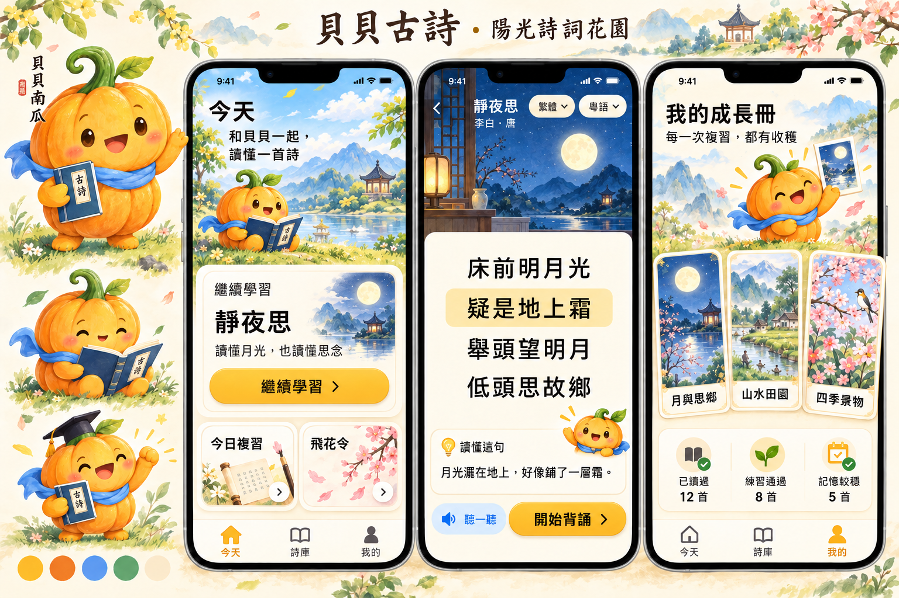

# 贝贝古诗：页面视觉风格与设计规范

- 版本：v0.1，设计方向提案
- 日期：2026-10-22
- 适用范围：面向低龄儿童与青少年的 iPhone / iPad 古诗学习 App
- 产品依据：[产品功能设计与分阶段排期](product-design-and-roadmap.md)
- 品牌名称：贝贝古诗；主题角色：**贝贝南瓜**；「贝贝」谐音「背背」。

## 1. 推荐方向：阳光绘本里的诗词花园

让孩子进入一个明亮、有生命力的诗词世界：金黄色的贝贝南瓜带着诗集，走过月下庭院、青绿山水和四季花园；每读懂、记住、复习一首诗，都为自己的成长册增加一份收获。

整体采用 **明快黄蓝配色＋精致绘本插画＋圆润卡片＋轻量立体层次**。角色亲切有趣，画面有诗意与细节，操作清晰。首页产生探索欲，阅读页帮助沉浸，完成页给予有依据的成就感。

关键词：阳光、诗意、陪伴、探索、成长、精致卡通。避免黑白灰商务界面、满屏低饱和灰色卡片，也避免满屏高饱和色、廉价贴纸堆叠和过度幼儿化。

### 参考稿如何使用

参考《贝贝古诗项目设计方案(1).pdf》第 5.4 节（PDF 第 53–56 页，文内页码 41–44）。参考稿明确采用黄色主色、蓝色辅色；南瓜角色具有圆润瓜瓣、绿色瓜柄、粉色腮红与不同动作；页面采用暖黄色背景、浅色圆角容器，并包含地图式游戏入口。

本方案保留黄蓝关系、南瓜识别特征与探索感，重新设计角色比例、画面质感和信息层级。原稿的白色线描角色发展为轮廓更清晰的暖橙实体角色；大面积黄色界面调整为奶油底色与黄蓝重点区域；不同风格的素材统一为绘本插画。

功能范围以当前产品文档为准。参考稿中的五栏导航、积分商城、在线排行和智能评分不直接沿用到第一阶段。

## 2. 设计示意图

**阅读方式：**左侧观察角色和配色，右侧依次观察首页的吸引力、阅读页的信息清晰度、成长册的收集感。三个页面展示同一套品牌如何随学习场景调整插画比重。

本图由内置 imagegen 工具生成，用于确认美术气质、构图与角色方向。图中文字、控件尺寸与示例进度不作为最终验收依据；正式设计以本规范和产品内容为准。正式 UI 的正文、状态、图标与按钮需要独立制作，不使用整张图片充当可操作页面。生成提示词见 [image-generation-prompt.txt](design/image-generation-prompt.txt)。

## 3. 贝贝南瓜角色规范

### 3.1 形象与身份

贝贝南瓜是一位爱读诗、会思考、愿意陪伴孩子反复练习的学习伙伴。可以给提示、做示范、庆祝进步，语气平等自然。

| 项目 | 设计要求 |
| --- | --- |
| 核心轮廓 | 圆润略扁的南瓜主体，约五条柔和瓜瓣结构；主体本身就是南瓜，配短小手脚 |
| 主体颜色 | 金黄到暖橙的柔和明暗关系，保留明确的南瓜辨识度 |
| 识别特征 | 绿色卷曲瓜柄、一片小叶、深棕眼睛、淡粉腮红 |
| 表情 | 温暖、自信、好奇；眼睛简洁，避免过大的婴儿式眼睛和夸张水光 |
| 配件 | 默认一条天蓝小围巾；读诗时携带小诗集，配件不能遮住南瓜外形 |
| 特别装扮 | 学士帽用于阶段完成，诗意主题配件用于限定场景；日常保持简洁 |
| 风格 | 以 2D 绘本为主，少量柔和体积和纸感；角色、场景、徽章统一光源与笔触 |
| 避免 | 万圣节镂空脸、尖牙、恐怖南瓜、真人套头、塑料玩具质感、无关角色混搭 |

第一阶段需要六种状态：招手欢迎、翻书领读、托腮思考、指向提示、鼓掌庆祝、温和鼓励。答错时保持耐心，不哭泣、不生气、不表现失望。

### 3.2 出现位置与大小

- 首页：角色融入顶部插画，与一个明确的学习入口共同构成视觉焦点。
- 阅读、背诵：角色缩小到辅助位置，不遮挡诗句、不持续跳动；可隐藏辅助提示。
- 小测：提交后才出现简短反馈，避免答题时抢夺注意力。
- 完成、成长册：允许更明显的动作，庆祝与本次实际学习成果对应。
- 图标：使用简化南瓜脸和绿叶，小尺寸下省略书本、手脚等细节。

### 3.3 文案声音

用具体反馈代替泛泛夸奖。示例使用繁体，以匹配香港默认界面：

| 场景 | 建议文案 |
| --- | --- |
| 欢迎 | 「和貝貝一起，讀懂一首詩。」 |
| 提示 | 「想一想，詩人眼前看到的是甚麼？」 |
| 答错 | 「再看看『明月光』，這裡寫的是月光。」 |
| 练习通过 | 「這次你把四句詩都排對了！」 |
| 复习成功 | 「隔了一天，你還記得這首詩。」 |

减少「宝宝」「乖乖」等年龄限定称呼。不要用「贝贝会伤心」催促学习，不以角色饥饿、哭泣或消失制造压力。

## 4. 配色规范

以下 HEX 是**本次建议的设计色值**，并非参考 PDF 的原始取色值。角色与插画允许在此基础上扩展明暗色；界面组件使用固定语义色。

| 色名 | 色值 | 用途 |
| --- | --- | --- |
| 南瓜金 | `#FFB928` | 品牌主色、主要按钮、当前学习节点、奖励高光 |
| 南瓜橙 | `#F58A38` | 角色阴影、插画暖色、局部装饰；避免大面积铺底 |
| 天空蓝 | `#5B9BF3` | 天空、听读区域装饰、主题插画 |
| 深湖蓝 | `#285DAD` | 音频操作、链接、需要白字的蓝色按钮 |
| 新叶绿 | `#61B879` | 叶片、花园、成长主题插画 |
| 深叶绿 | `#287657` | 成功状态文字、图标、通过标签 |
| 桃粉 | `#F58D96` | 腮红、花朵与小范围温暖点缀 |
| 提示红 | `#B84145` | 需修正答案的文字和图标，避免整屏错误红 |
| 奶油底 | `#FFF8E8` | 默认页面背景、阅读背景 |
| 暖白 | `#FFFEFA` | 主要内容卡片、弹层 |
| 可可棕 | `#3D3028` | 标题、诗句、主要正文 |
| 栗子棕 | `#756052` | 作者、说明、次要正文 |
| 浅金边 | `#EBD7AC` | 非关键分隔线和装饰边框 |

### 4.1 使用规则

- 普通内容页可从「约 65% 浅色底与阅读区域、25% 主题画面、10% 高饱和强调」开始设计；它是构图建议，不是固定像素配额。
- 首页和完成页可提高插画占比。阅读、背诵、小测页应明显降低装饰密度。
- 一屏只突出一个主要操作。黄金色主要按钮配深棕文字；不要使用白色小字叠在黄色按钮上。
- 天空蓝、南瓜橙、新叶绿优先用于图形；正文使用深色版本。深蓝可以承载白色按钮文字。
- 月夜可以使用靛蓝与月金，春日可以使用青绿与桃粉，山水可以使用湖蓝与嫩绿；导航、主操作与角色保持品牌一致。
- 背景渐变用于天空、光照和场景氛围。诗文区使用稳定、足够不透明的浅色底。
- 不仅靠颜色表达状态；同时给出文字、图标、边框或形状变化。

### 4.2 对比度基线

按 WCAG 对比度公式计算，不透明纯色组合如下：

| 前景 / 背景 | 对比度（约） |
| --- | --- |
| 可可棕 / 南瓜金 | 7.40:1 |
| 可可棕 / 奶油底 | 12.01:1 |
| 栗子棕 / 奶油底 | 5.59:1 |
| 白色 / 深湖蓝 | 6.44:1 |
| 白色 / 深叶绿 | 5.50:1 |
| 白色 / 提示红 | 5.41:1 |

普通文字目标至少 4.5:1，大号文字至少 3:1；关键控件边界和状态图形目标至少 3:1。实际渐变、透明度和图片背景需要在正式页面重新检查。浅金边仅用于装饰，不单独承担输入框或选中状态识别。

## 5. 插画与诗意场景

美术方向是「有东方诗意的彩色绘本」。通过月亮、庭院、远山、柳树、小舟、荷叶、飞鸟等意象表现古诗，用简洁远近层次与细腻光线建立精美感。

| 主题 | 画面建议 | 页面应用 |
| --- | --- | --- |
| 月与思乡 | 靛蓝夜空、淡金月亮、窗棂、月光落在庭院 | 《静夜思》、思乡主题、月下诗词卡 |
| 山水田园 | 青绿山丘、湖蓝水面、小舟与远山 | 主题入口、山水诗学习页 |
| 四季景物 | 春花、夏荷、秋叶、冬雪，按具体诗意选用 | 主题封面、四季卡组 |

每幅插画先确认与诗句含义相符。例如《静夜思》的「霜」是月光引起的联想，不能把地面画成真实积雪而误导理解。贝贝南瓜可以站在画面边缘带领观察，不应取代诗中的主体。

纹理只出现在插画或容器边缘，正文底部保持干净。不要混合写实照片、网络水墨图、塑料 3D 和扁平表情贴纸。精美来自统一的形体、配色、光影与叙事。

## 6. 兼顾年龄的呈现策略

使用同一套角色、导航和组件，依据学习阶段调整信息量与引导程度。第一阶段按产品文档优先服务小四至小六，兼顾中一基础复习；低龄与更高年级规范为延伸方向，不要求首版增加独立模式。

| 维度 | 低龄友好方向 | 小学高年级默认 | 青少年进阶方向 |
| --- | --- | --- | --- |
| 插画 | 场景直观，角色引导较明显 | 精致绘本，角色适量出现 | 保留彩色诗意场景，减少角色出场频次 |
| 文案 | 一次一个短指令 | 简明解释和自主操作 | 自然平等，增加意象、情感与表达分析 |
| 信息密度 | 每步只呈现必要内容 | 原诗＋逐句解释，深入内容展开 | 可展开赏析、主题联系与进阶挑战 |
| 互动 | 听读、点选、简单配对 | 隐词、排序、飞花令 | 自主回忆、主题比较和表达 |
| 激励 | 明确的完成反馈 | 诗词卡、主题徽章、复习成果 | 强调积累、掌握证据与个人最佳 |

青少年页面仍然明快、有插画，不通过变成灰色报表来表示成熟。年龄差异主要体现在语言、信息密度与学习内容，而不是强制更换品牌外观。

## 7. 关键页面设计

### 7.1 今天：首页像一本打开的诗词绘本

从上到下：问候与贝贝场景 → 继续学习主卡 → 今日建议复习 → 推荐一首诗／飞花令入口 → 底部导航。

首屏插画建议约占内容高度的四分之一至三分之一，让「继续学习」在常见手机尺寸下可见。若尚无学习记录，主卡自然变成「开始第一首诗」。不要为了完整展示插画把主要入口挤到屏幕外。

主卡展示诗名、学习阶段和一个按钮，例如「继续理解」「继续背诵」。复习卡显示实际建议复习数量，不用虚构紧迫感。飞花令是次要入口，出现在首页与学习完成页。

底部导航严格保持「今天／诗库／我的」三项；香港默认呈现「今天／詩庫／我的」。地图式探索可作为主题页的视觉表达，不取代清晰的主导航。

### 7.2 诗库：像挑选一本想读的小诗集

顶部搜索支持诗名与诗句，下面按主题、难度、诗人、学习状态筛选。主题封面采用月夜、山水、四季插画；诗卡保留诗名、作者与清晰的学习状态。

iPhone 以易读的单列诗卡为基础；iPad 根据可用宽度使用多列主题卡和列表。避免为了展示封面缩小诗名和说明。

### 7.3 古诗详情：画面引入诗境，正文成为中心

上方放精简主题插画与标题作者，中间放完整诗文，下方展开当前句释义与朗读操作。示例《静夜思》使用蓝色月夜与奶油阅读卡。

点击诗句时，用浅金背景和明确边缘指示当前句，在相邻区域展开「读懂这句」。重点字词可以点击显示词义和读音；「再想一想」按需展开，不把所有注释同时铺满屏幕。

繁简与朗读语言是两个独立控件，例如「繁體」和「粵語」。界面要允许「繁体＋普通话」和「简体＋粤语」，不能合并成一个地区开关。

### 7.4 背诵：一层层减少提示

完整正文 → 隐藏关键词 → 显示首字 → 隐藏全文。用有文字的阶段选择器，保持诗句位置稳定；隐藏处使用有宽度的柔和占位，避免布局突然跳动。

始终提供「听一句」「看提示」等清楚入口。恢复提示不会触发扣分或责备。贝贝在边缘轻声鼓励，练习期间不持续播放装饰动画。

「我记住了」标记为自评，不直接显示「已掌握」。练习结果与跨日复习表现分别呈现。

### 7.5 小测与飞花令：轻松游戏，答案解释清楚

题目居中，选项使用大圆角容器。选择态采用深蓝边框、浅蓝底和选中图标；提交后的通过态使用绿色图标与文字，需修正态给温和红色标识、答案解释与重试入口。

排序支持拖动，也应支持点选移动等替代操作。题目提交前不提前泄露答案状态。

飞花令采用花瓣或诗签作为装饰，保留足够大的答题区；默认不倒计时。展示「本轮范围：已学诗库」。未收录答案使用中性提示「暂未收录」，不能使用判错红叉。

### 7.6 我的／成长册：把学习积累变成可翻阅的收藏

成长册采用诗词明信片、主题图鉴与少量徽章。月夜、山水、四季形成系列卡面，卡片外观体现不同诗境。

明确区分「已读过」「练习通过」「记忆较稳」。首次有效学习获得诗词卡，跨日复习体现熟练度提升，修正错题获得进步反馈。装饰性的种子、叶芽、南瓜可以作为成长隐喻，但不能替代状态文字或任意暗示掌握程度。

展示个人篇目、复习情况和个人最佳，不展示伪造的好友或排行榜。漏学一天不让角色枯萎、不清空成长成果。设置入口保持可见，首版不放账号登录要求。

## 8. 字体、布局与组件

以下是逻辑点 pt 的初始建议，正式 SwiftUI 实现需随 Dynamic Type 调整。

| 项目 | 建议规范 |
| --- | --- |
| 界面字体 | 支持繁简中文的系统中文字体；标题适度加粗，以圆角容器和图形建立亲和感 |
| 诗文选字 | 优先清晰、规范的中文字形；可试用可读性良好的宋体／明体风格，但需验证繁体显示与低龄识字 |
| 页面标题 | 26–32 pt，semibold；手机通常从 28 pt 起 |
| 诗句正文 | 26–32 pt 起，随设备与用户字号调整；低龄展示可增大 |
| 正文与释义 | 17–20 pt，行高约字高的 1.5–1.7 倍 |
| 辅助文字 | 14–16 pt，重要说明不依赖极小字 |
| 中文排版 | 正文不人为拉开字距；诗句按原有分行展示，不能为挤入容器压缩字体 |
| 基础间距 | 采用 4 pt 步进，常用 8 / 12 / 16 / 24 / 32 |
| 手机页边距 | 通常 20–24 pt；窄屏和大字号情况下弹性调整 |
| 卡片 | 圆角 20–24 pt，内边距 16–20 pt，暖白／奶油底 |
| 按钮 | 高度 52–56 pt 起，圆角 16–20 pt，文字＋必要图标 |
| 触控区域 | 至少 44 × 44 pt，低龄主要操作建议 48–56 pt；相邻目标留足间距 |
| 标签 | 胶囊形，用于主题与状态；需要点击时扩展可触控区域 |
| 图标 | 统一圆角线形，常用 24 pt 视觉尺寸、约 2 pt 线宽；关键功能附文字 |
| 层次 | 柔和暖棕阴影，透明度约 8%–12%；避免所有元素都悬浮 |

诗文不使用难辨的装饰书法体、气泡字或花体。品牌字标可单独定制，学习内容保持规范汉字。传统文化感主要由内容、插画和留白建立。

iPad 使用可用宽度驱动布局：宽屏可左侧诗库、右侧详情，或左侧原诗、右侧释义。窄窗口和大字号退回单列，不把手机截图简单等比放大。底部操作避开安全区域与键盘，所有关键内容可滚动访问。

## 9. 动效、声音与无障碍

- 按压反馈约 120–180 ms，面板展开和页面转场约 200–300 ms；动作轻快、幅度小。
- 朗读时当前句高亮与音频同步，装饰动画不与阅读争夺注意力。
- 成功动画建议 600–900 ms，并允许立即继续；不强制等待完整庆祝。
- 跟随系统「减少动态效果」设置，降低位移、缩放和循环动画；信息不能仅通过动画表达。
- 诗歌音频由用户主动播放，始终提供暂停；默认不自动播放背景音乐。
- 支持动态字号和 VoiceOver；朗读按钮提供当前状态，排序与题目提供可访问的替代操作。
- 繁简切换覆盖界面、正文、释义、题目和反馈；文字切换与粤普音频选择相互独立，不丢失学习进度。

## 10. 第一阶段交付与验收建议

设计优先完成六组页面：今天、诗库、古诗详情与注释、分层背诵、小测与单人飞花令、完成页与成长册。覆盖无记录、学习中、答对、需修正、待复习和暂无收录等真实状态。

建议美术资产为一套贝贝南瓜基础设定及六种姿态、三组主题插画、与首批 12 首诗相配的诗词卡封面，以及统一的基础图标。主题图可以复用构图和色板，具体诗意应逐首核对。

| 验收维度 | 判断标准 |
| --- | --- |
| 品牌识别 | 去掉标题仍能凭南瓜、黄蓝关系与画风识别为同一产品 |
| 学习入口 | 首页能快速找到继续学习和今日复习 |
| 阅读体验 | 原诗比装饰更醒目；大字号下不截断、不遮挡 |
| 年龄包容 | 低龄看得懂操作，青少年不被过度幼儿化的语言劝退 |
| 插画准确 | 场景与诗意一致，未用画面强化错误理解 |
| 状态真实 | 自评、练习结果与跨日记忆状态清楚区分 |
| 对比与操作 | 文字对比度、触控大小、VoiceOver 和减少动态效果经过检查 |
| 产品一致 | 三项主导航、繁简与粤普独立设置、首版离线流程符合产品文档 |

本提案交付的是视觉方向和可执行的基础规范。下一步正式页面设计应沿「选诗 → 理解 → 背诵 → 小测 → 飞花令 → 成长册」验证完整流程，并邀请目标年龄学生判断画面是否有吸引力、操作是否清楚。
